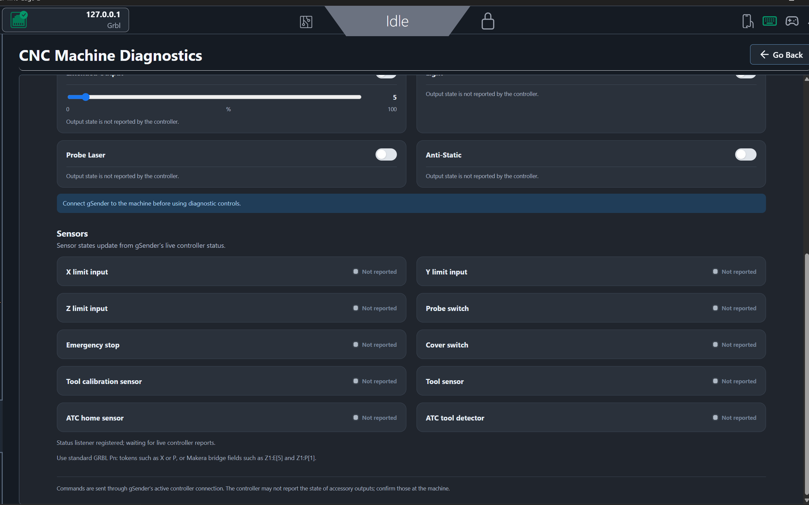

# Makera Z1 TCP Bridge

A standalone Windows TCP bridge specifically for the **Makera Z1**. It connects gSender or another GRBL-style sender to the Z1 and translates individual commands, status messages, firmware settings, and Z1 sensor fields. It is separate from gSender and its plugins.

This bridge supports the Makera Z1 protocol. It does not currently support other CNC controller protocols.



## Quick start

1. Download and extract the [v0.3.19 release package](https://github.com/bakstaaj/Makera-Z1-TCP-Bridge/releases/download/makera-z1-tcp-bridge-v0.3.19/makera-z1-tcp-bridge-v0.3.19.zip). Verify it with the adjacent `.sha256` file if desired.
2. Open PowerShell **as Administrator**, change to the extracted folder, and run `Install-Z1Bridge.ps1`.
3. Choose automatic discovery when prompted. The installer listens for Z1 beacons on UDP `3333`, then lets you select a detected machine. If discovery does not find one, enter its IP address and TCP port manually; the usual Z1 port is `2222`.
4. In gSender, select **Ethernet** and connect to host `127.0.0.1`, port `2323`, using the GRBL profile.

The installer creates `C:\makera_z1_tcp_bridge`, writes `config.yaml`, and installs the `MakeraZ1TcpBridge` Windows service. These service and data-directory names are retained for in-place updates. The executable does not require a separate Python installation. YAML stores the Z1 connection, local listener, optional rotary setting, debug logging, and fallback GRBL profile.

## Open the connection settings UI

After installation, open the Windows **Start** menu and search for **Configure Makera Z1 TCP Bridge**. You can also open **All apps > Makera Z1 TCP Bridge > Configure Makera Z1 TCP Bridge**. Windows may ask you to approve administrator access.

In the settings window, click **Discover Z1** to listen for UDP `3333` beacons, select a detected machine, or enter the IPv4 address and TCP port manually. Click **Save and restart service** to apply the new connection. You do not need to reinstall the bridge to change its address after this UI is installed.

Installations created before this UI was added do not have the Start menu shortcut yet. Run `Install-Z1Bridge.ps1` from the updated package once to add it; your existing configuration is retained as the installer's defaults.

If you installed the v0.3.19 test package and its shortcut opens a **Missing Shortcut** dialog, extract the corrected package and run `Fix-ConfigureShortcut.ps1` as Administrator. It repairs the Start menu link and refreshes the UI files without restarting or reinstalling the bridge service.

## Supported Makera Z1 translations

- Forwards G-code commands and Z1 responses in both directions.
- Translates GRBL status and firmware-version requests.
- Reads the Z1 `/sd/config.txt` for GRBL settings and saves a local copy when available.
- Translates `$J=` jog commands, jog cancel, and GRBL Ctrl-X halt.
- Maps Z1 sensor fields to GRBL `Pn:` tokens where possible and preserves extended values in a `Z1:` status field.
- Polls Z1 diagnostics while gSender is connected to refresh accessory and sensor status.
- Provides loopback upload and local-play APIs at `http://127.0.0.1:2324/api/upload` and `/api/play`. Uploads and `play /sd/gcodes/<filename>` are multiplexed over the active gSender-to-Z1 connection, so gSender stays connected for monitoring.
- Uploads into `/sd/gcodes/` and confirms the file there before local playback.

The bridge translates individual commands. Probing and tool changes remain the responsibility of the sender and are sent as G-code/controller commands. The CNC Job Setup plugin uploads and verifies `/sd/gcodes/<filename>`, then asks the bridge to send the same `play /sd/gcodes/<filename>` text command used by Makera Studio. The bridge waits for the Z1's `ok` response before confirming the start request. gSender stays connected to monitor controller state and SD progress; it does not stream the job's G-code lines.

## Configuration and troubleshooting

The installed configuration is `C:\makera_z1_tcp_bridge\config.yaml`. The service binds to `127.0.0.1`, so it accepts sender connections from this computer, not other network devices.

Set `logging.debug: true` and restart the service to record command and response frames under `C:\makera_z1_tcp_bridge\logs`. Turn debug logging off after troubleshooting to reduce log volume.

```powershell
Get-Service MakeraZ1TcpBridge
Restart-Service MakeraZ1TcpBridge
```

The bridge downloads the Z1’s `/sd/config.txt` at connection time and saves a copy in `C:\makera_z1_tcp_bridge\config.txt` when available. The YAML `grbl-settings` block is used only as a fallback and is not written to the Z1.

Set `rotary.installed: true` only when the optional A-axis module is attached, then restart the service and reconnect gSender. The module is not detected automatically.

## Update and uninstall

For an in-place update, run `Update-InstalledService.ps1` from an elevated PowerShell window. It replaces the executable and restarts the service while preserving YAML configuration and logs.

To remove the Windows service, run `Uninstall-Z1Bridge.ps1` as Administrator. The data directory, configuration, and logs are retained.

## Build from source

The optional build uses the Windows .NET Framework C# compiler included with supported Windows versions. It does not need a Python installation or a .NET SDK.

```powershell
.\Build-Bridge.ps1
.\Package-Bridge.ps1
```

`Package-Bridge.ps1` creates the standalone ZIP in the repository root.

## Protocol and validation

Protocol translation is based on captured Makera Studio traffic and the published Z1 firmware source. gSender connection, basic commands, jogs, status fields, config transfer, and Windows service installation have been exercised during development. A successful package build does not prove every machine state, sensor, or complete job has been validated. Supervise motion and verify sensor mappings on the actual Z1.

## Package contents

The ZIP includes the prebuilt bridge executable, NSSM service wrapper and notice, installer, bridge configuration UI, shortcut repair helper, Z1 discovery script, update/uninstall scripts, C# source, build/package scripts, README, and screenshot.

## Release notes

### 0.3.19

- Added a Start menu configuration UI to rerun Z1 UDP discovery, edit the controller IP and TCP port, and restart the bridge service without reinstalling.
- The UI preserves local listener settings, handles Windows CRLF configuration files, and confirms restart by checking that the new bridge process owns port 2323.
- Added a shortcut repair helper for installations of the earlier 0.3.19 test package.
- Published package: [makera-z1-tcp-bridge-v0.3.19.zip](https://github.com/bakstaaj/Makera-Z1-TCP-Bridge/releases/download/makera-z1-tcp-bridge-v0.3.19/makera-z1-tcp-bridge-v0.3.19.zip).

### 0.3.18

- Added UDP 3333 Makera Z1 discovery to bridge setup, with selection when multiple machines are found and manual address entry as a fallback.
- Published package: [makera-z1-tcp-bridge-v0.3.18.zip](https://github.com/bakstaaj/Makera-Z1-TCP-Bridge/releases/download/makera-z1-tcp-bridge-v0.3.18/makera-z1-tcp-bridge-v0.3.18.zip).

### 0.3.17

- Added the loopback `/api/play` endpoint for starting an uploaded Z1 SD-card file through the active gSender connection.
- The bridge waits for the controller's `ok` response before reporting that the local playback request was accepted.
- Suppressed background diagnostics polling while file upload and playback commands use the active connection.
